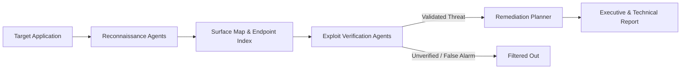

# <p align="center">S.W.A.R.M.</p>

<p align="center">
  <strong>Autonomous AI Security Intelligence for Modern Web Applications</strong>
</p>

<p align="center">
  <a href="https://swarm-ai.me"></a>
  
  
</p>

---

## 🦅 Overview

**S.W.A.R.M.** deploys coordinated AI agents that analyze your web applications through the eyes of an attacker. Rather than overwhelming teams with hundreds of noisy "maybe" vulnerabilities, S.W.A.R.M. rigorously validates every potential finding and gives you clear, verified fixes you can deploy immediately.

> *Your personal web security team — built for high-velocity teams who need real peace of mind without false-alarm fatigue.*

---

## 🛡️ The Three Pillars

```
┌─────────────────┐       ┌─────────────────┐       ┌─────────────────┐
│     1. FIND     │  ──▶  │    2. PROVE     │  ──▶  │     3. FIX      │
│  Attack Surface │       │ Validation Engine│      │ Actionable Steps│
└─────────────────┘       └─────────────────┘       └─────────────────┘
```

### 1. 🔍 Find — Complete Attack Surface Discovery
* We map every page, public endpoint, software dependency, and configuration parameter across your application.
* Identifies hidden routes, outdated components, and subtle injection surfaces.

### 2. 🧪 Prove — Elimination of False Alarms
* Traditional scanners report theoretical risks. S.W.A.R.M. safely attempts reproduction in an isolated context.
* If a risk cannot be substantiated, it does not clutter your dashboard. You only receive confirmed, high-signal alerts.

### 3. 🛠️ Fix — Plain-English Remediation
* Every confirmed risk comes with step-by-step guidance tailored to your specific framework and code patterns.
* No obscure CVE jargon — just actionable patches you can ship today.

---

## 🤖 Multi-Agent Workflow



---

## 🔒 Safe Testing & Verified Ownership

- **Strict Authorization:** S.W.A.R.M. requires verified domain ownership via DNS TXT record or site token before running tests.
- **Safe Mode Default:** Starts with passive inspection that sends zero attack traffic.
- **Controlled Scope:** Only touches domains and endpoints explicitly approved by you.

---

<p align="center">
  <sub>© S.W.A.R.M. All rights reserved. Proprietary software. Visit <a href="https://swarm-ai.me">swarm-ai.me</a> for waitlist and early access.</sub>
</p>
